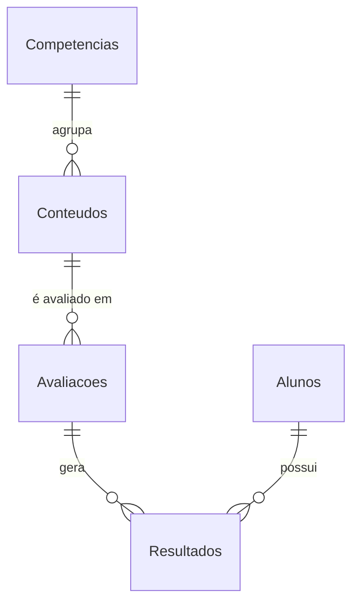

# Mapa de Progresso de Inglês

Sistema web de estudo para um professor de inglês mapear as dificuldades dos alunos e acompanhar a evolução mês a mês, cruzando o desempenho em atividades, conteúdos e provas.

**Versão atual:** `v0.1.0` (protótipo de front-end + modelo de banco de dados)
**Data:** 11/11/2026
**Status:** front-end estático pronto; back-end e dashboard ainda não implementados.

---

## Sumário

1. [Visão geral](#visão-geral)
2. [O que já está pronto](#o-que-já-está-pronto)
3. [Estrutura do projeto](#estrutura-do-projeto)
4. [Como executar](#como-executar)
5. [Design e paleta de cores](#design-e-paleta-de-cores)
6. [Acessibilidade](#acessibilidade)
7. [Banco de dados (SQL Server)](#banco-de-dados-sql-server)
8. [Arquitetura sugerida para o back-end](#arquitetura-sugerida-para-o-back-end)
9. [Dashboard](#dashboard)
10. [Limitações conhecidas](#limitações-conhecidas)
11. [Roadmap](#roadmap)
12. [Changelog](#changelog)

---

## Visão geral

O professor registra as notas de atividades e provas, sempre ligadas a um conteúdo e a uma habilidade (Grammar, Vocabulary, Listening, Speaking, Reading, Writing). O sistema calcula a média percentual por aluno, habilidade e mês, compara com o mês anterior e destaca quem está abaixo de 60%.

## O que já está pronto

**Front-end (`index.html`)**

- Cartões de alunos com nível, maior dificuldade, barra de progresso e variação entre outubro e novembro
- Cartões explicativos ("Como funciona")
- Busca por nome e filtros por habilidade
- Carrossel de destaques do mês
- Formulário de contato com validação
- Alternância entre modo claro e escuro, com preferência salva no navegador
- Rodapé completo (sobre, navegação, contato, acessibilidade e aviso de LGPD)

**Banco de dados (`banco_de_dados.sql`)**

- 6 tabelas, 2 views para o dashboard, dados de exemplo e um usuário somente leitura (comentado)

## Estrutura do projeto

```
.
├── index.html            # HTML + CSS + JS em um único arquivo
├── banco_de_dados.sql    # Script T-SQL (SQL Server)
└── README.md
```

Para separar o front-end, mova o conteúdo de `<style>` para `estilo.css` e o de `<script>` (ao final do arquivo) para `app.js`, e referencie os dois no `<head>`.

## Como executar

### Front-end

Abra o `index.html` no navegador. Se preferir um servidor local:

```bash
python -m http.server 8000
# acesse http://localhost:8000
```

A fonte **Atkinson Hyperlegible** é carregada do Google Fonts. Sem internet, a página usa Verdana ou a fonte do sistema.

### Banco de dados

Requisitos: SQL Server 2016 SP1 ou superior (o script usa `CREATE OR ALTER VIEW`).

1. Abra `banco_de_dados.sql` no SQL Server Management Studio (SSMS) e execute, ou rode:

   ```bash
   sqlcmd -S localhost -E -i banco_de_dados.sql
   ```

2. O script cria o banco `AcompanhamentoIngles`, as tabelas, as views e os dados de exemplo.

> **Atenção:** o script deve ser executado uma única vez. Rodar de novo gera erro nas tabelas que já existem. Para recriar tudo, apague o banco antes: `DROP DATABASE AcompanhamentoIngles;`

## Design e paleta de cores

Proporção aplicada: **50% branco, 30% azul escuro, 20% preto**.

| Cor | Valor | Uso | Efeito pretendido |
|---|---|---|---|
| Branco | `#FFFFFF` | Fundo e áreas de leitura | Clareza e menos fadiga visual |
| Azul escuro | `#0B2A5B` | Cabeçalho, carrossel, cartões | Seriedade e confiança |
| Preto | `#0A0A0A` | Texto e rodapé | Foco e hierarquia |

No **modo escuro** as proporções se invertem: o preto domina, o azul vem em seguida e o branco fica só no texto. Os links e destaques passam a usar azul claro (`#8DB4FF`) para manter o contraste.

Contrastes calculados (aproximados):

| Combinação | Razão |
|---|---|
| Branco sobre azul escuro | 14:1 |
| Preto sobre branco | 19:1 |
| Azul claro sobre preto | 9:1 |

Todos acima do mínimo AA (4,5:1) e do nível AAA (7:1) para texto.

## Acessibilidade

O código foi escrito seguindo as diretrizes da WCAG 2.2 (nível AA como meta):

- Link "Pular para o conteúdo" e tags semânticas (`header`, `nav`, `main`, `section`, `article`, `footer`)
- Foco visível em todos os controles e alvos de toque com pelo menos 44 px
- Filtros com `aria-pressed` e contagem de resultados anunciada por `role="status"`
- Carrossel sem rotação automática, com botões e navegação pelas setas do teclado
- Formulário com `label` em todos os campos, foco no primeiro erro e mensagens escritas (o erro não depende só da cor)
- Respeito a `prefers-reduced-motion` e `prefers-color-scheme`

**Ainda é preciso validar:** rodar Lighthouse ou axe e testar com um leitor de tela (NVDA, VoiceOver) antes de considerar a conformidade confirmada.

## Banco de dados (SQL Server)

### Modelo



### Tabelas

| Tabela | Função |
|---|---|
| `Alunos` | Cadastro do aluno e nível (A1 a C2) |
| `Competencias` | Habilidades: Grammar, Vocabulary, Listening, Speaking, Reading, Writing |
| `Conteudos` | Tópicos ensinados, ligados a uma habilidade |
| `Avaliacoes` | Atividades e provas, ligadas a um conteúdo, com data e nota máxima |
| `Resultados` | Nota de cada aluno em cada avaliação (única por aluno e avaliação) |
| `Contatos` | Mensagens enviadas pelo formulário do site |

### Views para o dashboard

| View | O que entrega |
|---|---|
| `vw_DesempenhoMensal` | Média percentual por aluno, habilidade e mês |
| `vw_EvolucaoMensal` | Média do mês, média do mês anterior, variação em pontos e marcação `EmDificuldade` (abaixo de 60%) |

Exemplo de consulta:

```sql
SELECT Nome, Competencia, Mes, MediaPct, MediaMesAnterior, Variacao
FROM dbo.vw_EvolucaoMensal
WHERE EmDificuldade = 1 OR Variacao < 0
ORDER BY Mes DESC, Variacao;
```

Se um aluno não tiver nota em um mês, a comparação é feita com o último mês em que houve nota.

## Arquitetura sugerida para o back-end

```
Navegador (index.html)  →  API (ASP.NET Core ou Node)  →  SQL Server
                                                      ↘  Power BI (somente leitura, nas views)
```

- **API:** ASP.NET Core Minimal API com Dapper ou EF Core. Node com o pacote `mssql` também serve.
- **Regra principal:** o navegador nunca acessa o banco diretamente. A connection string fica só no servidor (variável de ambiente ou cofre de segredos).
- **Segurança:** consultas parametrizadas, autenticação do professor, HTTPS e usuário de banco com o menor privilégio possível.
- **LGPD:** os dados de alunos (e de menores, se houver) exigem base legal, acesso restrito e política de retenção.

Endpoints sugeridos:

| Método | Rota | Descrição |
|---|---|---|
| `GET` | `/api/alunos` | Lista alunos com a evolução (lê `vw_EvolucaoMensal`) |
| `POST` | `/api/resultados` | Registra a nota de um aluno em uma avaliação |
| `POST` | `/api/contatos` | Grava a mensagem do formulário de contato |

**Como ligar o front-end:** no `index.html`, troque o array `alunos` por uma chamada `fetch('/api/alunos')` e implemente o `TODO` do formulário de contato.

## Dashboard

O dashboard ainda não foi construído. Duas opções:

1. **Power BI:** em *Obter dados → SQL Server*, conecte nas views `vw_DesempenhoMensal` e `vw_EvolucaoMensal`, usando o usuário somente leitura.
2. **Dentro do site:** uma biblioteca de gráficos (por exemplo Chart.js) consumindo a API, com tabela alternativa para leitores de tela.

## Limitações conhecidas

- Os dados exibidos no site são fictícios e estão fixos no JavaScript.
- O formulário de contato valida os campos, mas **ainda não envia** a mensagem a nenhum servidor.
- Não há login, cadastro de alunos nem lançamento de notas pela interface.
- O script SQL não é reexecutável (ver aviso em [Como executar](#como-executar)).
- O carrossel usa slides de texto. Para imagens, use `` com `alt` descritivo.
- Nenhum teste automatizado foi escrito.

## Roadmap

- [x] `v0.2.0`: API com `GET /api/alunos` e `POST /api/contatos`
- [x] `v0.3.0`: login do professor e tela de lançamento de notas
- [ ] `v0.4.0`: dashboard (Power BI ou gráficos no site)
- [ ] `v0.5.0`: auditoria de acessibilidade com leitor de tela e correções
- [ ] `v1.0.0`: versão estável, com documentação da API

## Changelog

### v0.1.0, 11/11/2026

- Primeira versão do front-end: cartões, cartões explicativos, busca e filtros, carrossel, formulário de contato, modo claro/escuro e rodapé
- Paleta 50% branco, 30% azul escuro, 20% preto, com versão para modo escuro
- Primeira versão do banco de dados: 6 tabelas, 2 views, dados de exemplo e usuário de leitura (comentado)